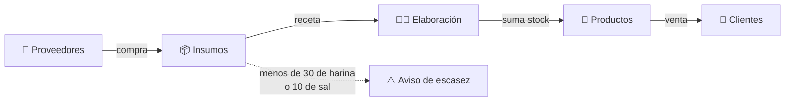
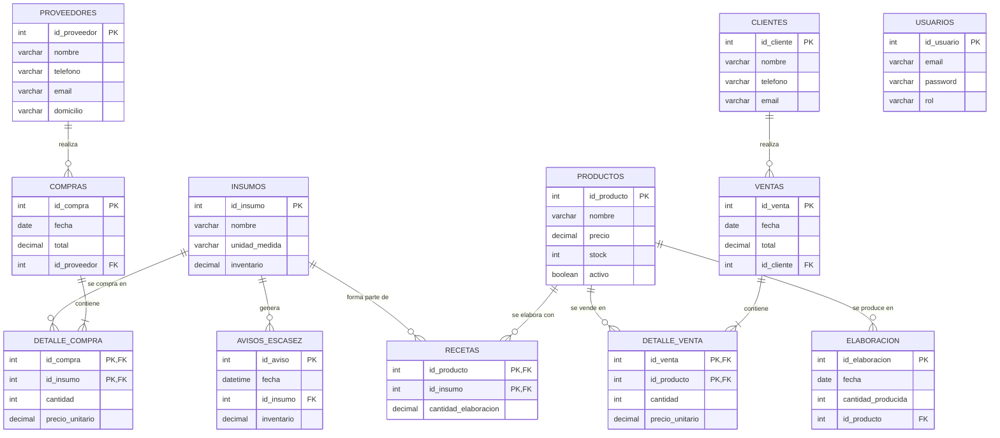

<div align="center">

# 🥟 Sistema de Gestión — Fábrica de Tapas de Empanadas

**Proyecto Integrador · Base de Datos I + Programación I · Comisión 1° 1°**

Controla el circuito completo de una fábrica: **compra de insumos → elaboración → venta**,
con usuarios por rol, recetas por docena y avisos automáticos de escasez.


[Funcionalidades](#-funcionalidades) ·
[Instalación](#-instalación) ·
[Base de datos](#️-base-de-datos) ·
[Estructura](#-estructura-del-proyecto)

</div>

---

## 📌 Sobre el proyecto

La fábrica compra **insumos** (harina, grasa, sal, bolsas) a proveedores, los usa para **elaborar productos**
(discos de empanadas de 11 a 22 cm y tapas de pascualina) según una receta, y **vende** esos productos a clientes.



El proyecto tiene dos partes que trabajan juntas:

- **Base de datos MySQL**: guarda la información y garantiza su coherencia con claves foráneas, un **procedimiento almacenado** y un **trigger**.
- **Programa en Python (consola)**: cada usuario inicia sesión y ve un menú distinto según su **rol**.

---

## ✨ Funcionalidades

| Rol | Puede hacer |
|---|---|
| 👑 **admin** | ABM de usuarios, clientes, proveedores, productos e insumos · Reportes de ventas y compras con detalle |
| 🛒 **compras** | ABM de proveedores e insumos · Registrar compras (suma inventario) · Historial con detalle · Avisos de escasez |
| 💰 **ventas** | ABM de clientes · Ver productos · Registrar ventas (controla y descuenta stock) · Historial con detalle |
| 👩‍🍳 **elaboracion** | Ver productos, insumos y recetas · Registrar elaboraciones (verifica insumos) · Historial |

**Reglas de negocio que respeta el sistema:**

- ✅ No se puede vender más de lo que hay en stock.
- ✅ No se puede elaborar si faltan insumos para la receta.
- ✅ Toda venta tiene un cliente y toda compra un proveedor.
- ✅ No se puede borrar un registro con historial (por ejemplo, un cliente con ventas).
- ✅ No puede haber dos usuarios con el mismo email.
- ✅ Las compras, ventas y elaboraciones se guardan completas o no se guardan (transacciones).
- ⚠️ Si la harina baja de 30 o la sal de 10, se genera un aviso automático.

---

## 🚀 Instalación

### Requisitos

- [Python 3.8+](https://www.python.org/downloads/)
- [MySQL 8.0](https://dev.mysql.com/downloads/) (recomendado: MySQL Workbench)

### 1. Clonar el repositorio

```bash
git clone https://github.com/erubitar/Integrador.git
cd Integrador
```

### 2. Crear la base de datos

En MySQL Workbench, crear la base y ejecutar los scripts de la carpeta [`Base de Datos/`](Base%20de%20Datos) **en este orden**:

```sql
CREATE DATABASE integrador;
USE integrador;
```

| Orden | Script | Qué hace |
|:---:|---|---|
| 1 | `1 - Creacion de Tablas.sql` | Crea las tablas con sus claves primarias y foráneas |
| 2 | `2 - Insertar datos.sql` | Carga los datos de ejemplo |
| 3 | `4 - Procedimientos almacenados.sql` | Crea `registrar_elaboracion` |
| 4 | `5 - Trigger de escasez.sql` | Crea la tabla de avisos, `verificar_escasez` y el trigger |
| — | `3 - Creacion y permisos de Usuarios.sql` | *Opcional:* usuarios de MySQL con permisos por rol |

### 3. Instalar dependencias

```bash
cd Programacion
pip install -r requirements.txt
```

### 4. Configurar la conexión

Editar [`Programacion/db/database.py`](Programacion/db/database.py) con los datos de tu MySQL:

```python
DB_CONFIG = {
    "host": "localhost",
    "database": "integrador",
    "user": "root",
    "password": "tu_contraseña"
}
```

### 5. Ejecutar

```bash
python main.py
```

---

## 🔑 Usuarios de prueba

| Rol | Email | Contraseña |
|---|---|---|
| admin | `mrodrigo@tapitas.com` | `muysegura` |
| compras | `lbarrera@tapitas.com` | `masomenos` |
| ventas | `mpacifico@tapitas.com` | `regular` |
| elaboracion | `ebitar@tapitas.com` | `insegura` |

> [!TIP]
> En cualquier pregunta podés escribir `c` o presionar `Ctrl+C` para cancelar y volver sin guardar.

### Así se ve

```text
========================================
   TAPAS EMPANADAS - Sistema de Gestión
========================================
Email: ebitar@tapitas.com
Contraseña: insegura

✔ Bienvenido/a, ebitar@tapitas.com! (Rol: elaboracion)
...
--- Verificando insumos necesarios ---
  Harina 0000: necesario=3.571 Kg | disponible=50.00 Kg  ✔
  Harina 000: necesario=0.143 Kg | disponible=3.00 Kg  ✔
  Grasa: necesario=0.071 Kg | disponible=130.00 Kg  ✔
  Sal: necesario=0.064 Kg | disponible=65.00 Kg  ✔
  Bolsa 25x35: necesario=0.016 Rollo | disponible=5.00 Rollo  ✔

¿Confirmar elaboración? (s/n): s

✔ Elaboración registrada. 10 unidades producidas.
⚠ AVISO DE ESCASEZ: quedan 2.86 Kg de Harina 000. Avisar a compras.
```

---

## 🗄️ Base de datos



### Automatización en la base

| Objeto | Tipo | Qué hace |
|---|---|---|
| `registrar_elaboracion(producto, cantidad)` | Procedimiento | Registra la elaboración, descuenta los insumos según la receta y suma el stock |
| `tr_escasez_insumos` | Trigger | Después de cada `UPDATE` en `insumos`, si el inventario bajó, llama a `verificar_escasez` |
| `verificar_escasez(...)` | Procedimiento | Guarda un aviso si quedan menos de 30 de harina o menos de 10 de sal |

> [!NOTE]
> Las recetas están expresadas **por paquete de una docena**. En el script 2 cada cantidad se escribe dividida por las docenas
> que rinde una tanda, por ejemplo `(2, 1, 25 / 70)`: 25 kg de harina rinden 70 docenas del disco de 11 cm.

---

## 📁 Estructura del proyecto

```text
Integrador/
├── Base de Datos/                       Scripts SQL y diagrama (MySQL Workbench)
└── Programacion/
    ├── main.py                          Punto de entrada: login y menú según el rol
    ├── requirements.txt
    ├── auth/login.py                    Inicio de sesión (3 intentos)
    ├── db/
    │   ├── database.py                  Conexión a MySQL
    │   └── seed.py                      (Opcional) usuarios de prueba
    ├── menus/
    │   ├── crud.py                      Listar / Agregar / Modificar / Eliminar reutilizable
    │   ├── admin.py
    │   ├── compras.py
    │   ├── ventas.py
    │   └── elaboracion.py
    └── utils/entrada.py                 Ingreso y validación de datos
```

**Decisiones de diseño:**

- **CRUD reutilizable**: cada tabla se describe con un diccionario (nombre, clave y campos con su tipo) y las mismas funciones sirven para las cinco tablas maestras.
- **Consultas parametrizadas** (`%s`) en todas las consultas con datos del usuario, para evitar la inyección SQL.
- **Transacciones** con `commit` / `rollback` en compras, ventas y elaboraciones.
- **Menú por rol** resuelto con un diccionario: `MENUS[rol](usuario)`.

---

## 🚧 Limitaciones y mejoras futuras

- [ ] Guardar las contraseñas con *hash* (hoy están en texto plano).
- [ ] Conectar el programa con un usuario de MySQL por rol en lugar de `root`.
- [ ] Agregar una columna `stock_minimo` para que cada insumo tenga su propio límite de escasez.
- [ ] Leer las credenciales de MySQL desde variables de entorno.

---

## 👥 Integrantes

- Emmanuel Bitar
- Leonardo Barrera
- Rodrigo Matías
- Pacifico Matias

<div align="center">

Proyecto Integrador de Base de Datos I y Programación I · 2026

</div>
